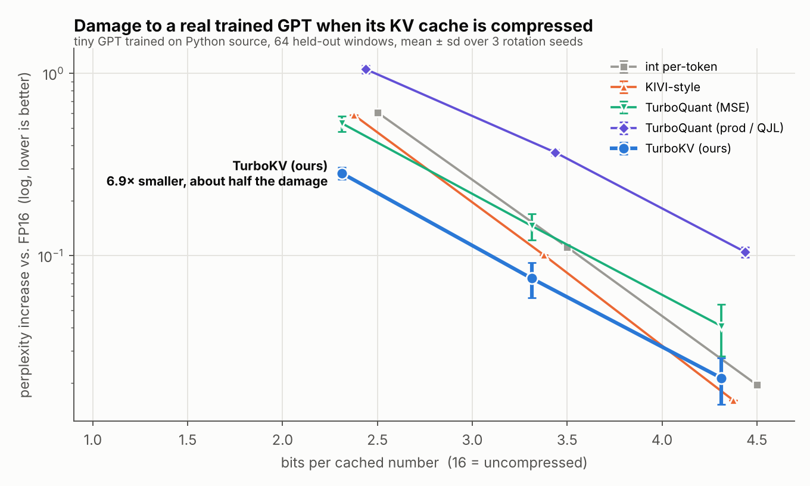
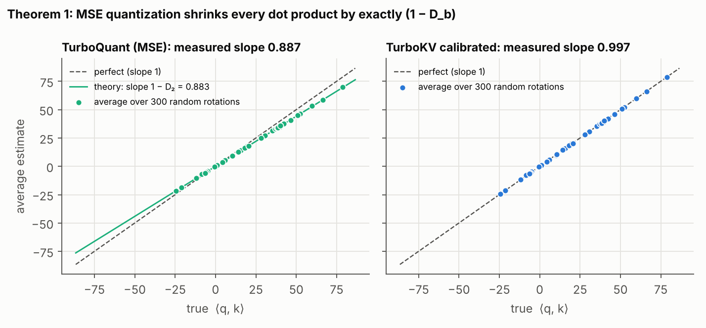
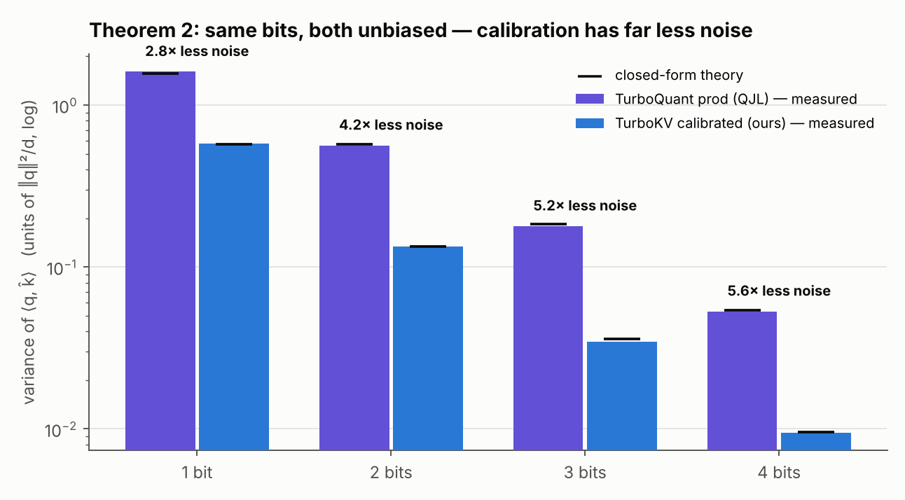

# TurboKV

KV-cache compression for LLMs. Stores keys and values in 2–4 bits instead of 16, and at 2 bits does
roughly half the perplexity damage of TurboQuant and KIVI-style quantization, without using any extra bits.



**Why the name:** TurboKV starts from Google's [TurboQuant](https://arxiv.org/abs/2504.19874) (2025) and
fixes a bias in it. TurboQuant spends one extra bit per number to correct that bias. TurboKV corrects it
for free, with less noise. The rest of this page shows the math and the experiments behind that claim.

## Why this matters

During generation, a transformer caches the key and value vectors of every past token so it doesn't
recompute them. That cache grows linearly with context length. For long contexts it can be larger than the
model weights, and since decoding is memory-bandwidth bound, reading it is a large share of the cost of
each new token. Shrinking the cache 4–7× means longer contexts, bigger batches, and less memory traffic
per token.

## Results

A 4-layer GPT trained from scratch on Python source (`examples/tiny_gpt.py`). Every attention layer reads
from the compressed cache, and we measure the perplexity increase on held-out code. FP16 perplexity is 7.39.
Rotation-based rows are mean ± sd over 3 random rotation seeds.

| bits / number | int per-token | KIVI-style | TurboQuant (MSE) | TurboQuant (prod) | TurboKV |
|---|---|---|---|---|---|
| ~4.3 (3.7× smaller) | +0.020 | **+0.016** | +0.041 ± .013 | +0.104 ± .007 | +0.021 ± .006 |
| ~3.3 (4.8× smaller) | +0.111 | +0.101 | +0.145 ± .023 | +0.367 ± .014 | **+0.075 ± .016** |
| ~2.3 (6.9× smaller) | +0.608 | +0.589 | +0.530 ± .051 | +1.050 ± .051 | **+0.282 ± .021** |

- **2 bits:** about half the damage of the best baseline, and 3.7× less than TurboQuant-prod (the
  variant built specifically for inner products), while using the fewest bits.
- **3 bits:** about 25% less damage than KIVI-style, with fewer bits.
- **4 bits:** tied with KIVI-style within noise. Once the bias is under 1%, there isn't much left to fix.

Bit counts include everything stored: codes, per-vector scales, and per-channel means.

## The idea

TurboQuant's recipe is: randomly rotate each vector (which spreads outlier channels evenly, so every
coordinate looks Gaussian), then round each coordinate with the optimal Lloyd-Max codebook for a Gaussian.
That's close to optimal for mean squared error. **But low MSE is not what attention needs.** Attention only
uses inner products ⟨q, k⟩, and the MSE-optimal quantizer gets those systematically wrong.

### 1. MSE quantization shrinks every logit by exactly (1 − D_b)

Let D_b be the Lloyd-Max distortion on N(0,1): 0.363, 0.118, 0.035 and 0.0095 at 1–4 bits. Averaged over
the random rotation,

$$\mathbb{E}[\hat{x}] = (1 - D_b)\,x \qquad\Rightarrow\qquad \mathbb{E}\,\langle q, \hat{x}\rangle = (1 - D_b)\,\langle q, x\rangle$$

Every attention logit gets multiplied by the same factor, which is the same as raising the softmax
temperature. At 2 bits attention runs about 12% too hot and blurs.

*Proof sketch.* (a) For any rotation U that fixes x, swapping R for RUᵀ leaves the codes unchanged and maps
x̂ to Ux̂. A uniformly random rotation is invariant under that swap, so E[x̂] is fixed by every rotation
around x, which means it must point along x. (b) Its length is E⟨x, x̂⟩ = Σᵢ E[yᵢ Q(yᵢ)]. Lloyd-Max's
centroid condition makes the rounding error uncorrelated with the rounded value, so E[Y·Q(Y)] = E[Q(Y)²] =
1 − D_b.



### 2. Unbiased for free: store a calibrated scale instead of the norm

TurboQuant-prod removes the bias by spending b−1 bits on the codebook and 1 bit per coordinate on a QJL
sign sketch of the residual. TurboKV keeps all b bits for the codebook and changes one number. Every
scheme already stores a per-vector norm; TurboKV stores this instead:

$$\alpha = \frac{\lVert x\rVert^2}{\langle x,\ R^\top c\rangle}, \qquad \hat{x} = \alpha R^\top c$$

Then ⟨x, x̂⟩ = ‖x‖² exactly, so the error w = x̂ − x is orthogonal to x. A reflection that fixes x and
negates its orthogonal complement maps w to −w without changing α or the codes, so E[w] = 0. The estimate
⟨q, x̂⟩ is unbiased for every vector, at zero bit cost.

### 3. And it has 2.8–5.6× less variance than QJL at the same bit budget

Both estimators are unbiased, so noise is what matters. In closed form, for unit vectors and in units of ‖q‖²/d:

| | 1 bit | 2 bits | 3 bits | 4 bits | formula |
|---|---|---|---|---|---|
| TurboQuant-prod (QJL) | 1.571 | 0.571 | 0.185 | 0.054 | (π/2)·D_{b−1} |
| TurboKV (calibrated) | **0.571** | **0.133** | **0.036** | **0.0096** | D_b / (1 − D_b) |

QJL's extra bit buys unbiasedness, but it costs a whole bit of codebook precision. The measured variances
match these formulas to within a few percent:



The per-vector scale is the same estimator [RaBitQ](https://arxiv.org/abs/2405.12497) uses for
approximate nearest-neighbor search. What's new here is the shrinkage result, pairing the estimator with
multi-bit Lloyd-Max codes in a KV cache, the variance comparison against QJL, and the end-to-end results.

## What didn't work

If the logits are unbiased but noisy, softmax over-sharpens. A second-order expansion of the attention KL
gives a closed-form per-query temperature that should fix this at zero cost:

$$a^* = 1 - \frac{A}{V}, \qquad A = \sum_j p_j(1-p_j)\,\sigma_j^2,\quad V = \mathrm{Var}_p(\hat{s})$$

On synthetic attention with diffuse heads, this noise-adaptive temperature (NAT) lands within 1–3% of the
best temperature found by grid search. On the real model it makes things worse: +0.33 vs +0.28 perplexity at
2 bits. The noise estimate itself was accurate (measured noise was 0.89× the prediction). What failed was
the Taylor expansion, which breaks on sharp heads: in the last layer NAT doubled the attention KL. It's
still in the code as `noise_aware=True`, off by default.

## How it works

```
k or v  →  subtract channel mean  →  random rotation  →  Lloyd-Max code per coordinate  →  store codes + α
           (exact under softmax)     (2 rounds of        (b bits each)                      (one fp16
                                      sign flip +                                            per vector)
                                      Hadamard, O(d log d))
```

Attention runs directly on the compressed cache. The query is rotated once, scores are computed against
codebook values in the rotated basis, values are mixed in the rotated basis, and one inverse rotation runs
per query instead of one per cached token.

## Usage

```bash
pip install numpy
python examples/quickstart.py
```

```python
from turbokv import TurboKVCache

cache = TurboKVCache(head_dim=128, key_bits=3, value_bits=3)
cache.append(k, v)       # (tokens, head_dim) arrays, append as tokens stream in
out = cache.attend(q)    # attention output computed on the compressed cache
cache.nbytes             # bytes actually stored, scales included
```

To compare methods on your own K/V tensors:

```python
from turbokv import compress_kv
r = compress_kv(K, V, "cal3/cal3")   # also: fp16, int4, kivi3, mse3/mse3, qjl3/mse3, ...
r.K, r.V, r.bits                     # reconstructed K/V and the true bits per number
```

## Reproducing the results

```bash
pip install numpy matplotlib torch pytest
pytest -q                                   # 39 tests, including numerical checks of each result above
python benchmarks/bench_attention.py        # synthetic benchmark with outlier channels
python examples/tiny_gpt.py                 # trains the GPT (~10 min on a laptop CPU)
for s in 0 1 2; do
  python examples/eval_perplexity.py --seqs 64 --seed $s --json results/tiny_gpt_seed$s.json
done
python benchmarks/make_figures.py           # regenerates every figure
```

A trained checkpoint is included at `examples/tiny_gpt.pt`, so the training step is optional. For GPT-2,
install `transformers` and run `python examples/eval_perplexity.py --hf gpt2 --text <any long text file>`.

## Limitations

- This is a NumPy reference implementation. The cache really is 4–7× smaller, but turning that into
  wall-clock speedups needs a fused GPU kernel, which is the obvious next step.
- The headline numbers come from a 1.9M-parameter model with head dim 64. The GPT-2 path works but hasn't
  been benchmarked yet. Results on larger models (Llama-class) are the main open question.
- The theory assumes a uniformly random rotation, and the fast Hadamard rotation approximates one.
  Measured shrinkage slopes match the predicted 1 − D_b to about 0.003.
- On the synthetic benchmark, KIVI-style per-channel quantization beats every rotation-based method at
  3–4 bits (`results/synthetic.txt`). On the trained model it only leads at 4 bits.

## Layout

```
turbokv/
  quantizer.py   TurboQuantMSE, TurboQuantProd (QJL), TurboQuantCal (this work)
  hadamard.py    fast Walsh-Hadamard transform, randomized rotation
  lloyd_max.py   optimal Gaussian codebooks via Lloyd's algorithm
  cache.py       TurboKVCache: streaming compressed cache + attention
  methods.py     shared interface for all methods, NAT
  baselines.py   int per-token, KIVI-style per-channel
benchmarks/      synthetic benchmark, figure generation
examples/        quickstart, GPT trainer, perplexity eval (tiny GPT or GPT-2)
results/         raw numbers behind every table and figure
tests/
```

## References

- Zandieh et al., *TurboQuant: Online Vector Quantization with Near-optimal Distortion Rate*, 2025
- Zandieh et al., *QJL: 1-Bit Quantized JL Transform for KV Cache Quantization*, 2024
- Gao & Long, *RaBitQ: Quantizing High-Dimensional Vectors with a Theoretical Error Bound*, 2024
- Liu et al., *KIVI: A Tuning-Free Asymmetric 2bit Quantization for KV Cache*, 2024
- Ashkboos et al., *QuaRot*, 2024; Tseng et al., *QuIP#*, 2024 (Hadamard rotations for LLM quantization)

All methods here, including the baselines, are implemented from scratch.

MIT License
